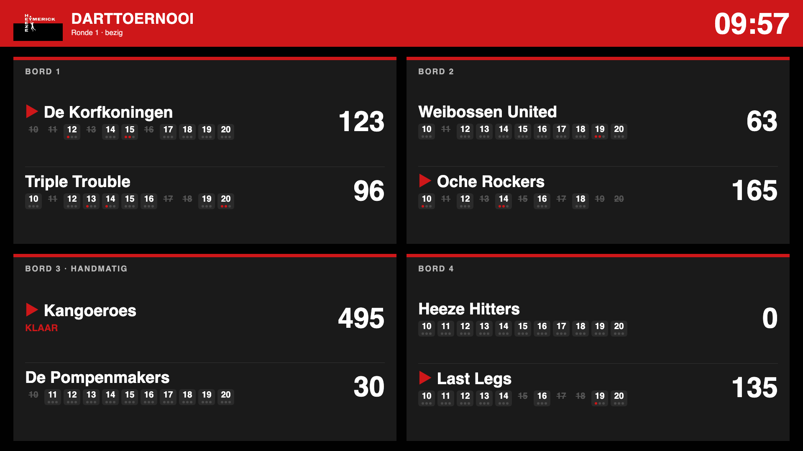
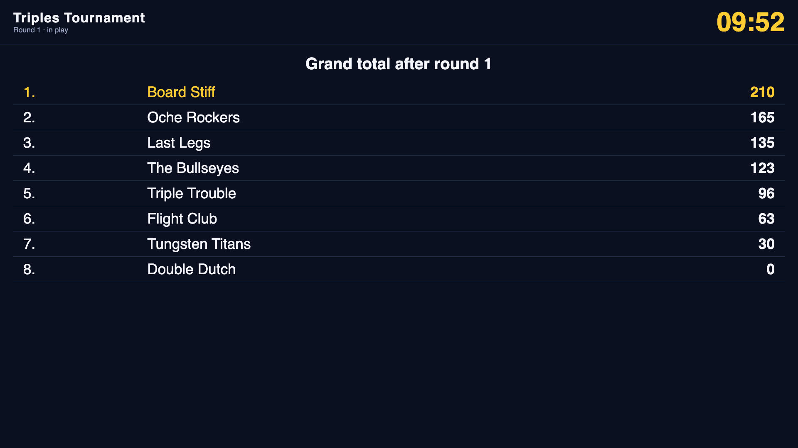
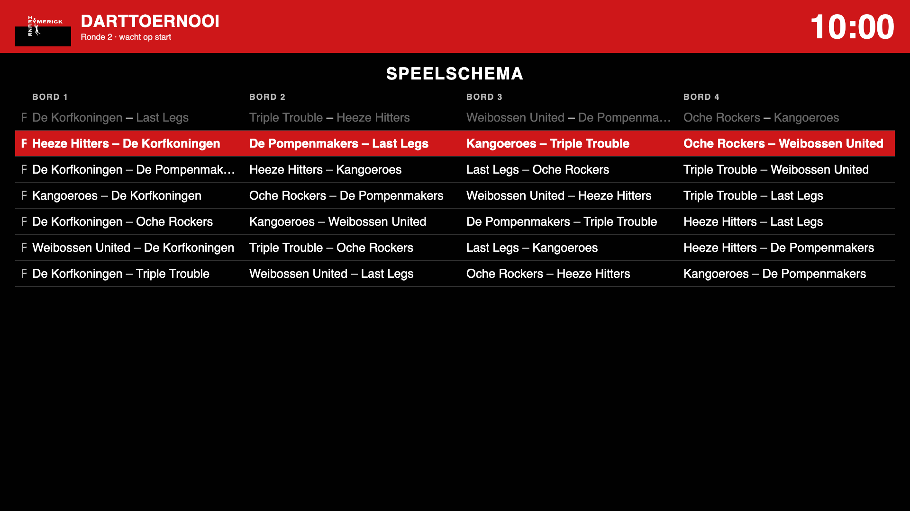

# Tournament mode: 4 boards, 8 teams, one big screen

Game: **triples**. Two teams per board. Each team must complete every
number from 10 up to 20, in any order the players choose. A number is
complete after three hits on it: a single counts one hit, a double two, a
triple three. Hits beyond the third on a number count for nothing. Points
per hit are the number's value, so a completed number is always worth three
times the number (10 = 30, 20 = 60). Teams alternate 3-dart visits. All four boards share one round timer. When time is up, every board locks and the big screen
switches to the grand total. Grand totals accumulate over rounds, keyed by team
name, so teams can rotate boards between rounds.

Hardware recommendations are in [HARDWARE.md](HARDWARE.md).

To change the numbers, the hits needed or the points, edit
`tournament/rules.py` and the matching `TARGETS` and `HITS_NEEDED` in the
three pages under `tournament/static/`.

## What it looks like

Big screen during a round, the grand total when time is up, and the schedule
between rounds:





Organiser control page and the manual scoring page for one board (phone):

 

## Parts

| Part | Where | Runs on |
|------|-------|---------|
| Central server | `python tournament/server.py --port 8000 --boards 4 --duration 600` | any machine on the venue network |
| Big screen | `http://<server-ip>:8000/` | TV or beamer, any browser, full screen |
| Organiser control | `http://<server-ip>:8000/control` | organiser's phone or laptop: teams, schedule, rounds, corrections |
| Manual scoring | `http://<server-ip>:8000/board?n=1` | fallback if a camera fails: one tap per hit, undo |
| Camera scoring | `python board.py --board N ...`, or `python boards.py` for several boards on one machine | one process per board |

The server only needs Python 3, no extra packages. State is saved to
`tournament/state.json` after every change, so a restarted server keeps scores
and totals. Start with `--fresh` to wipe it.

## Running a round

1. Start the server. Note the laptop's IP address.
2. Open `/control`. Enter the teams, one per line, and save. Press
   `Generate round robin`: every team meets every other team once (7 rounds
   for 8 teams on 4 boards). Lower the number of rounds to play part of it,
   or change any match in the table and save. Set the round duration.
3. On each board laptop run one command and leave it alone:

   ```
   python board.py --board 1 --server http://192.168.0.10:8000 --camera 0
   ```

   No menus, no typing at the board. Team names come from the control page.
   The window shows `Waiting for round start`. (`GUI.py` still works for a
   manual setup via the menus.) To run several boards on one machine, for
   example with network cameras, use `boards.py`, which starts one process
   per camera and restarts a board that crashes (USB cameras are opened at
   1920x1080 in MJPEG mode; change with `--width`, `--height`, `--fps`):

   ```
   python boards.py --server http://192.168.0.10:8000 --cameras rtsp://cam1/stream1 rtsp://cam2/stream1
   ```
4. Open `/` on the big screen.
5. Press `Start round` in `/control`. The boards get the teams of that round
   from the schedule, reset to 0, and the countdown starts everywhere.
6. When the timer hits zero every board shows `TIME`, stops accepting scores,
   and the big screen shows the grand total.
7. Press `Next round` to add the round to the totals and reset the boards.
   The next round's teams appear on the boards and the big screen shows the
   schedule with that round highlighted until you press `Start round` again.
   `Teams on the boards now` lets you override a match by hand.

`Stop now` ends a round early. The display override in `/control` forces the
big screen to boards, totals or the schedule regardless of the timer.

## Corrections by the organiser

The control page shows every number per team with dots for the hits so far.
One click per hit the camera missed (a double is two clicks, a triple three);
switch to `take back` to remove hits. `set` overrides the points. Use them when a camera missed a dart or scored the wrong one. A correction
reaches the big screen and the board app within a second: the board app
adopts the corrected score and target and continues from there. Corrections
also work after time is up, so a disputed result can still be fixed before
`Next round`.

## Look

The big screen uses the KV Eymerick club colours (red `#ce1719`, black, white)
and the club logo from `static/logo.png`, with Dutch labels. Swap the logo
file and the colour variables at the top of `static/display.html` for another
club.

## Board app behaviour

Designed for no hands at the board during play:

- Team names, round start, reset to zero, and the lock at time-up all come
  from the server. The organiser does everything from the control page.
- A visit commits by itself when the three darts are pulled. A visit with
  fewer than three detected darts (bounce-out, missed detection) commits by
  itself once the board has been empty for 3 seconds (`--auto-commit`).
- If the camera stream drops, the app keeps the score and reconnects every
  2 seconds.
- The board app reports after every change and polls the server every second.
  If the server is unreachable it keeps scoring locally using the fallback
  timer (`--timer`, or the setup screen in `GUI.py`), and shows `(server offline)`.
- A correction made on the control page is adopted by the board app within
  a second, so the board and the big screen never disagree.
- Camera options: `--camera` takes a USB index, an RTSP address or an IP
  Webcam host:port; `--width`/`--height`/`--fps` apply to USB cameras;
  `--device mps` or `--device 0` uses a GPU; `--model` loads an exported model.
- The server rejects score updates once the round is finished, so a late
  report cannot change the result.
- A team that has hit all numbers shows `Klaar` and scores no more.
- The existing manual controls still work: `Add dart`, click and drag a dart
  marker to correct it, Enter to commit a visit with a bounce-out.
