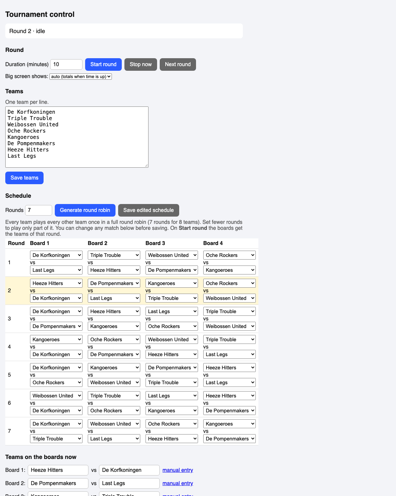
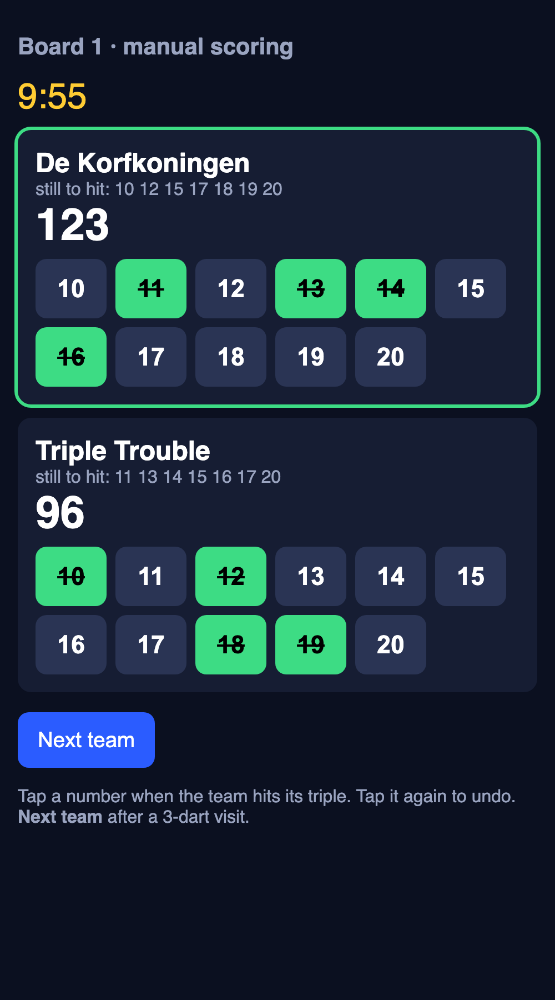

# Tournament mode: 4 boards, 8 teams, one big screen

Game: **triples**. Two teams per board. Each team must hit the triple of
every number from 10 up to 20, in any order the players choose. A dart only
counts if it is a triple of a number that team still has to do. Points per
hit are the normal dart value (T10 = 30, T20 = 60). Teams alternate 3-dart
visits. All four boards share one round timer. When time is up, every board locks and the big screen
switches to the grand total. Grand totals accumulate over rounds, keyed by team
name, so teams can rotate boards between rounds.

Hardware recommendations are in [HARDWARE.md](HARDWARE.md).

To change the numbers or the points, edit `tournament/rules.py` and the
matching `TARGETS` list in the three pages under `tournament/static/`.

## What it looks like

Big screen during a round, and the grand total when time is up:


Organiser control page and the manual scoring page for one board (phone):

 

## Parts

| Part | Where | Runs on |
|------|-------|---------|
| Central server | `python tournament/server.py --port 8000 --boards 4 --duration 600` | one laptop on the venue Wi-Fi |
| Big screen | `http://<server-ip>:8000/` | TV or beamer, any browser, full screen |
| Organiser control | `http://<server-ip>:8000/control` | organiser's phone or laptop |
| Manual scoring | `http://<server-ip>:8000/board?n=1` | fallback if a camera fails |
| Camera scoring | `python GUI.py`, game type `triples` | one Dart Sense instance per board |

The server only needs Python 3, no extra packages. State is saved to
`tournament/state.json` after every change, so a restarted server keeps scores
and totals. Start with `--fresh` to wipe it.

## Running a round

1. Start the server. Note the laptop's IP address.
2. Open `/control`, fill in the eight team names, set the round duration, save.
3. On each board laptop run one command and leave it alone:

   ```
   python board.py --board 1 --server http://192.168.0.10:8000 --camera 0
   ```

   No menus, no typing at the board. Team names come from the control page.
   The window shows `Waiting for round start`. (`GUI.py` still works for a
   manual setup via the menus.)
4. Open `/` on the big screen.
5. Press `Start round` in `/control`. All boards reset to 0 and the countdown
   starts everywhere.
6. When the timer hits zero every board shows `TIME`, stops accepting scores,
   and the big screen shows the grand total.
7. Press `Next round` to add the round to the totals and reset the boards.
   Rename teams per board if they rotate, then `Start round` again.

`Stop now` ends a round early. The display override in `/control` forces the
big screen to boards or totals regardless of the timer.

## Corrections by the organiser

The control page shows every number per team. Click a number to mark it as
hit when a camera missed it, click again to take it back; `set` overrides the
points. Use them when a camera missed a dart or scored the wrong one. A correction
reaches the big screen and the board app within a second: the board app
adopts the corrected score and target and continues from there. Corrections
also work after time is up, so a disputed result can still be fixed before
`Next round`.

## Look

The big screen uses the KV Eymerick club colours (red `#ce1719`, black, white)
and the club logo from `static/logo.png`, with Dutch labels. Swap the logo
file and the colour variables at the top of `static/display.html` for another
club.

## Board app behaviour

Designed for no hands at the board during play:

- Team names, round start, reset to zero, and the lock at time-up all come
  from the server. The organiser does everything from the control page.
- A visit commits by itself when the three darts are pulled. A visit with
  fewer than three detected darts (bounce-out, missed detection) commits by
  itself once the board has been empty for 3 seconds (`--auto-commit`).
- If the camera stream drops, the app keeps the score and reconnects every
  2 seconds.
- The board app reports after every change and polls the server every second.
  If the server is unreachable it keeps scoring locally using the fallback
  timer from the setup screen, and shows `(server offline)`.
- The server rejects score updates once the round is finished, so a late
  report cannot change the result.
- A team that has hit all numbers shows `Klaar` and scores no more.
- The existing manual controls still work: `Add dart`, click and drag a dart
  marker to correct it, Enter to commit a visit with a bounce-out.
